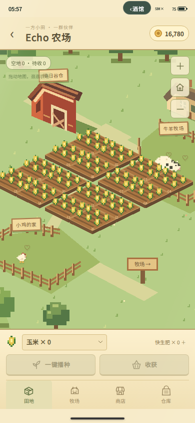
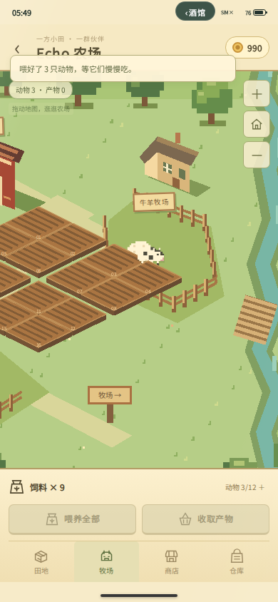
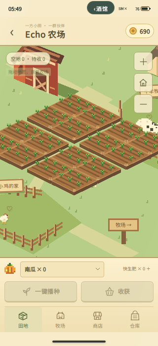

# 农场地图与牧场验收

日期：2026-10-23。农场提供斜视角可拖动地图、16块田地、10种作物及鸡羊牛养殖，沿用原有农场存储键并保留作物、金币和库存。

## 固定版本

- 黄米应用候选：`5e57e28cd45c7caedf915f8a4419b1a8d685a543`，Git tree为`a64b4aaf98222eb020c7b5f4c652b73de86e1a3f`。
- 真实宿主：SillyTavern 1.18.0，`51ad27fb86d39a3daca3adaa970375c9670c12df`。
- 浏览器：Chromium 153.0.8010.0；390×844和320×700手机视口，启用触屏模拟。

真实服务返回的10个文件逐字节核对通过：manifest、扩展入口、手机宿主、桌面布局、主题列表、农场数据模块、农场界面、作物图形、地图图形与农场CSS。SHA-256见`live/report.json`。此后的提交仅补验收脚本和记录，应用运行文件保持该候选。

## 结果

- Node自动回归：131项通过，0失败。命令为`node --import ./scripts/test-host-register.mjs --test tests/*.test.mjs`。
- 隔离宿主浏览器检查：25项通过，见`report.json`。脚本增加真实宿主模式后，原隔离模式复跑仍为25项通过。
- 本地真实SillyTavern联调：39项通过，页面脚本异常、扩展资源缺失、模型生成请求均为零，见`live/report.json`。

真实宿主由酒馆自身发现并加载扩展；脚本没有替换`/script.js`、群聊或世界书接口，也没有手工挂载手机。测试使用独立的数据目录和浏览器会话，打开实际角色聊天，经过真实酒馆后端读取聊天、保存设置及重载页面。正常宿主API请求另记在`hostRequests`，不将其称为“全部网络请求为零”。

两种浏览器模式均覆盖鼠标与CDP触屏输入、拖动不误播种、缩放保持中心、播种／施肥／收菜、购买鸡羊牛与饲料、分批产出、重复结算保护、小屏底栏命中、商店关闭、离开后旧控件失效、离线成熟、模式切换、整页重载及保存失败后重试。成熟等待使用浏览器可控时钟，界面和存储操作执行真实源码。

复验修复了两处交互问题：底部手机手势区域挡住商店按钮；商店Esc事件冒泡会同时关闭整个手机。对应检查已加入脚本。

## 范围

真实宿主阶段未安装世界背面，验证种植和养殖前后世界记录及手机余额、消费额没有变化，并检查未发出模型生成请求；不将其扩大为世界背面插件本体的联调结果。没有调用线上模型，也没有验收实体安卓设备。

截图来自隔离测试进度，不含用户聊天或密钥。为无中文系统字体的测试浏览器加载了仅用于截图的Noto Sans SC；该字体不写入产品资源。保持现有发行版本、自动更新设置，不发布Release。

## 复跑

安装Playwright并准备兼容的Chromium后，在仓库根目录运行`node tests/runtime-echo-farm.mjs`，默认使用隔离宿主。环境变量：

- `WP_PLAYWRIGHT_CORE_ENTRY`：Playwright或Playwright Core的可导入入口，默认`playwright`。
- `WP_CHROMIUM_EXECUTABLE`：Chromium可执行文件，默认使用Playwright浏览器。
- `WP_CHROMIUM_ARGS`：启动参数的JSON数组。本轮为`--no-sandbox --disable-dev-shm-usage --no-zygote`。
- `WP_FONT_DIR`：隔离模式下可选的Noto Sans SC目录，需包含`400.css`。
- `FARM_EVIDENCE_DIR`：报告和截图目录，默认`farm-evidence`。

真实宿主模式先启动一份使用独立数据目录的本地SillyTavern，将固定候选安装到测试账号的`extensions/yellowmi-24-pro-max-plus`，再设置：

- `FARM_REAL_HOST_URL`：该本地酒馆的地址。脚本只接受回环地址，并使用酒馆实际扩展加载器。
- `FARM_REAL_HOST_CHARACTER_ID`：可选，打开隔离测试数据中的指定角色编号；本轮为`0`。
- `FARM_INSTALLED_MANIFEST`：可选，含`files`对象的JSON文件，键为文件路径，值为候选文件的SHA-256，用于验证实际服务文件。
- `FARM_TEST_FONT_URL`：可选，同源测试字体CSS地址，只影响截图字体。

## 真实宿主截图

